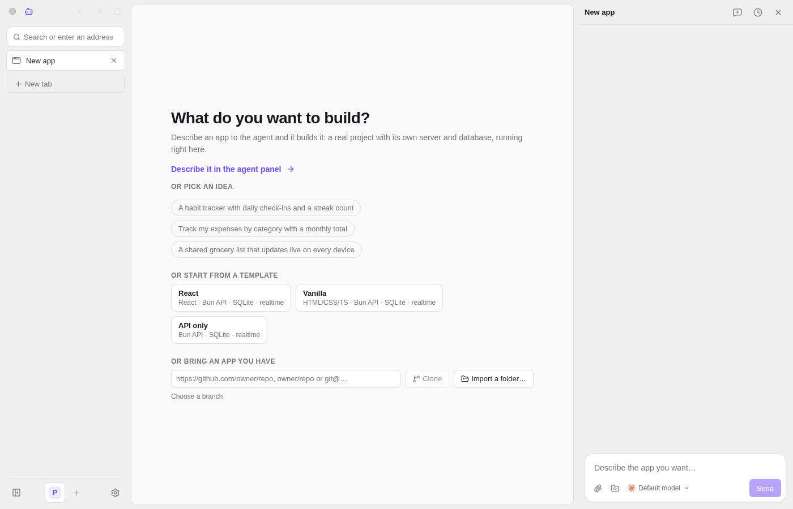
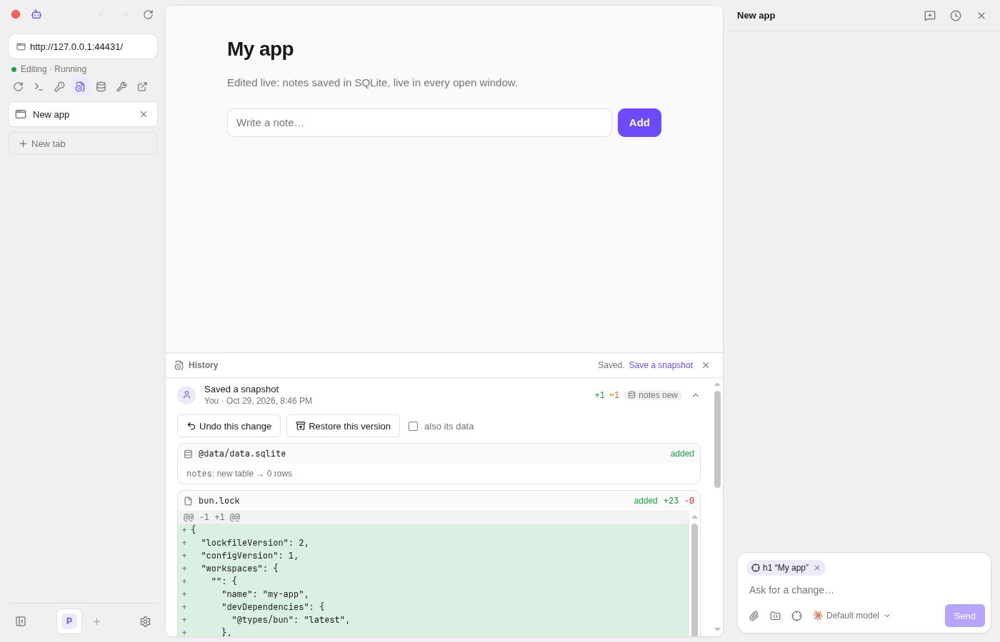
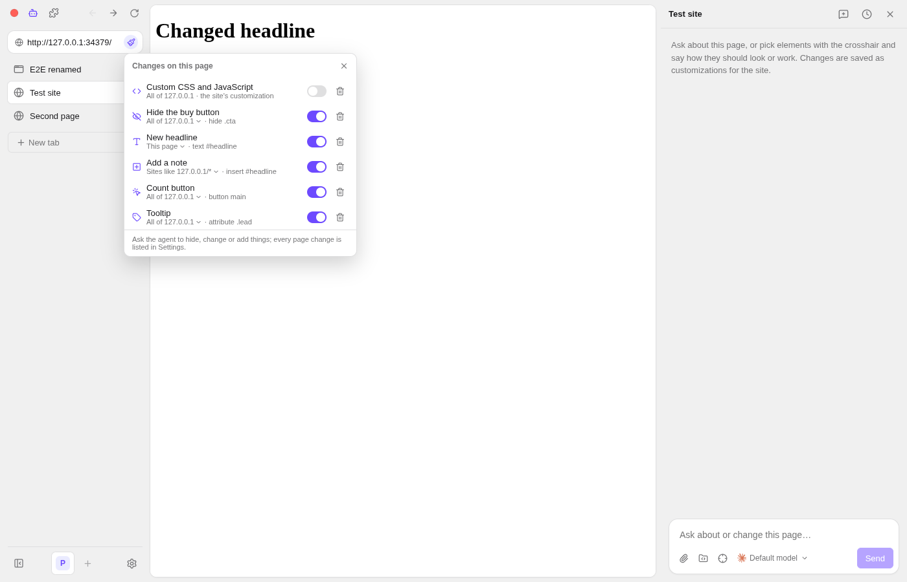
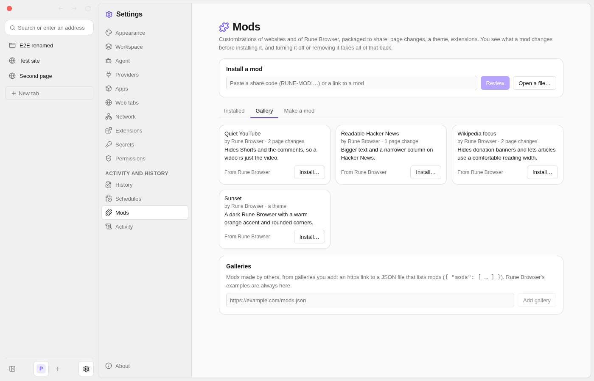

<p align="center">
  
</p>

<h1 align="center">Rune Browser</h1>

<p align="center">
  A desktop browser where coding agents build your own small apps,<br>
  and customize the websites you use, on your own Claude, Codex or OpenCode login.
</p>

<p align="center">
  <a href="https://github.com/nayupls1/rune-browser/releases/latest">Download</a> ·
  <a href="docs/concepts.md">Docs</a> ·
  <a href="https://github.com/nayupls1/rune-browser/issues">Issues</a>
</p>

---

Every tab in Rune Browser is a web page or an **app**. Describe an app and the
agent builds it: a real project with its own server and SQLite database,
running in a sandbox and shown in a live preview next to the chat. Keep
editing it by talking to the agent, or close the chat and use it. On web pages
the same agent can hide, restyle or add things, and those changes stay.



## What it does

- **Apps from a sentence.** "A habit tracker with daily check-ins": the agent
  writes a real project (React, vanilla or API-only, or whatever you ask for),
  runs it, and fixes what it sees in the preview. Apps can store data, use AI,
  run on a schedule, offer tools to agents, and read each other's data when you
  allow it.
- **Your own agents and logins.** Claude Code, Codex and OpenCode, the CLIs you
  already use, signed in with your own subscription. No API keys, no accounts
  here.
- **Websites your way.** Ask the agent about a page or point at an element:
  it hides, restyles or adds things, per page, site or pattern, each with its
  own switch. Bundle changes, a theme and extensions into a **mod** to share.
- **A real browser.** Workspaces with their own logins, split view, a command
  bar (Ctrl+K), Chrome extensions (imported from your browser), and password
  managers that fill in sign-ins.
- **Safe by default.** Apps run in a sandbox (bubblewrap on Linux) and ask
  before reaching anything beyond it; secrets never reach agents; web pages
  never reach an agent that has tools. Everything agents and apps do is in
  Activity.
- **Nothing is lost.** Every change is a snapshot in History, with its diff,
  to undo or restore, including the app's data.

|                                                                    |                                                                 |
| ------------------------------------------------------------------ | --------------------------------------------------------------- |
|  |  |
|              |                                                                 |

## Install

Get the latest release from the
[releases page](https://github.com/nayupls1/rune-browser/releases/latest).
Rune Browser updates itself from there (Settings → About; a Beta channel gets
pre-releases).

| OS                        | Download              | Notes                                                                                                                   |
| ------------------------- | --------------------- | ----------------------------------------------------------------------------------------------------------------------- |
| **Linux** (x64)           | `.AppImage` or `.deb` | Install [bubblewrap](https://github.com/containers/bubblewrap) (`bwrap`) so apps run sandboxed (the deb recommends it). |
| **Windows** (x64)         | `-setup-x64.exe`      | Not signed yet: on the SmartScreen warning, choose "More info" → "Run anyway".                                          |
| **macOS** (Apple Silicon) | `.dmg`                | Supported but untested, and not signed yet: right-click → Open the first time. Updates are downloaded by hand.          |

Then install and sign in to at least one agent:

- [Claude Code](https://claude.com/claude-code): `npm install -g @anthropic-ai/claude-code`, then `claude` → `/login`
- [Codex](https://github.com/openai/codex): `npm install -g @openai/codex`, then `codex login`
- [OpenCode](https://opencode.ai): `curl -fsSL https://opencode.ai/install | bash`

Rune Browser finds them on your `PATH` (or set their paths in Settings →
Providers).

## Build from source

With [Bun](https://bun.sh) installed:

```sh
bun install
bun run dev       # run it with hot reload
bun run check     # typecheck, tests, build, e2e
bun run package   # installers for this OS, in release/
```

More in [Development](docs/development.md).

## Docs

- [Concepts](docs/concepts.md): workspaces, apps and their data, agents, AI in
  apps, tools, schedules, secrets, permissions, history and mods
- [Interface](docs/interface.md): the window, sidebars, command bar, split view, settings
- [Browsing](docs/browsing.md): web tabs, page changes, network, extensions
- [Architecture](docs/architecture.md): processes, the server's services, where data lives
- [Development](docs/development.md) and [Releasing](docs/releasing.md)

Built with Electron and SolidJS (StyleX), and a local Bun server written with
Effect v4.

## Contributing

Issues are welcome: [bug reports](https://github.com/nayupls1/rune-browser/issues/new?template=bug_report.yml)
and [ideas](https://github.com/nayupls1/rune-browser/issues/new?template=feature_request.yml).
Pull requests aren't accepted yet, see [CONTRIBUTING.md](CONTRIBUTING.md).
Security issues go through [private reporting](SECURITY.md).

## License

[MIT](LICENSE)
